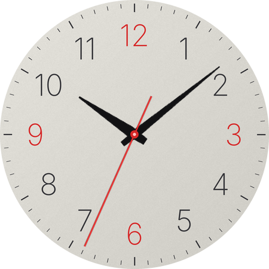
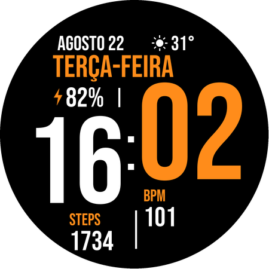
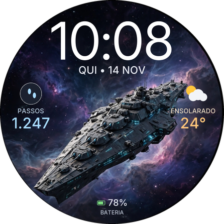

# Galaxy Watch Faces

Meus mostradores (watch faces) para o Galaxy Watch, todos no mesmo repositório.
Cada mostrador é um APK independente no **Watch Face Format (WFF)** — sem código,
só XML + imagens — instalado direto no relógio via `adb`.

## Galeria de watch faces

<!-- Para adicionar um mostrador: inclua uma nova célula <td> (3 por linha) usando o preview.png dele. -->
<table>
  <tr>
    <td align="center" width="33%">
      <br>
      <b>Classic Red</b><br>
      <code>faces/classic</code><br>
      <sub>Analógico creme, números finos (12/3/6/9 em vermelho), dia da semana, hora digital, bateria e nascer/pôr do sol</sub>
    </td>
    <td align="center" width="33%">
      <br>
      <b>Orange Digital</b><br>
      <code>faces/orange-digital</code><br>
      <sub>Digital grande (horas brancas, minutos laranja), data, bateria e 3 complicações editáveis: clima (Samsung Weather), passos e batimentos</sub>
    </td>
    <td align="center" width="33%">
      <br>
      <b>Space Cruiser</b><br>
      <code>faces/space-cruiser</code><br>
      <sub>Nave sobre nebulosa, hora e data no topo e 3 complicações editáveis: passos, clima (Samsung Weather) e bateria</sub>
    </td>
  </tr>
</table>

## Estrutura

```
faces/
  classic/                      ← um mostrador = uma pasta
    build.gradle.kts            ← só a versão (versionCode/versionName)
    art/generate_images.py      ← script que gera as imagens (opcional)
    src/main/
      AndroidManifest.xml
      res/raw/watchface.xml     ← o desenho do mostrador (WFF)
      res/xml/watch_face_info.xml
      res/values/strings.xml    ← nome que aparece na galeria do relógio
      res/drawable-nodpi/*.png  ← imagens + preview.png
build.gradle.kts                ← configuração comum a todos os mostradores
settings.gradle.kts             ← inclui automaticamente toda pasta em faces/
```

- O pacote vem do nome da pasta: `faces/classic` → `com.lsantos.watchfaces.classic`.
- Toda pasta em `faces/` com um `build.gradle.kts` vira o módulo `:faces:<nome>`
  sozinha, sem precisar registrar em lugar nenhum.

## Criar um mostrador novo

1. Copie uma pasta existente: `faces/classic` → `faces/meu-novo` (use letras minúsculas e `-`).
2. Mude o nome em `src/main/res/values/strings.xml` (`watchface_name`).
3. Edite `src/main/res/raw/watchface.xml` e troque as imagens em `res/drawable-nodpi/`
   (inclusive `preview.png`, que aparece na galeria).
4. Compile e instale (veja abaixo).
5. Adicione o mostrador na [Galeria](#galeria-de-watch-faces) usando o `preview.png` dele.

Referência do formato: <https://developer.android.com/training/wearables/wff>

## Conectar o relógio (adb sem fio)

Precisa fazer só uma vez:
1. No relógio, vá em Configurações → Sobre o relógio → Informações do software e toque
   várias vezes em "Versão do software" até ativar o modo desenvolvedor.
2. Vá em Opções do desenvolvedor e ative **Depuração ADB** e **Depurar por Wi‑Fi**.
3. Em **Depurar por Wi‑Fi → Parear novo dispositivo**, rode no PC:
   `adb pair IP:PORTA_PAREAMENTO` (digite o código mostrado no relógio).

Sempre que for instalar algo:

```bash
adb connect IP:PORTA          # IP:porta da tela "Depurar por Wi-Fi"
```

## Compilar e instalar

```bash
# Se o celular também estiver conectado no adb, diga qual é o relógio:
export ANDROID_SERIAL=IP:PORTA        # PowerShell: $env:ANDROID_SERIAL="IP:PORTA"

./gradlew :faces:classic:installRelease   # um mostrador
./gradlew installRelease                  # todos
```

Depois, toque e segure a tela do relógio e escolha o mostrador na galeria.
Para atualizar um mostrador que já está instalado, basta rodar o mesmo comando
(suba o `versionCode` se quiser controlar as versões).

Só gerar os APKs: `./gradlew assembleRelease` → `faces/<nome>/build/outputs/apk/release/<nome>-release.apk`

Remover um mostrador do relógio: `adb uninstall com.lsantos.watchfaces.<nome>`

## Requisitos

- Android SDK com a plataforma 36 (`local.properties` com `sdk.dir=...`; o Android Studio cria).
- Qualquer JDK no `JAVA_HOME` para iniciar o Gradle. O build em si roda com **JDK 17**,
  que o Gradle encontra sozinho (ver `gradle/gradle-daemon-jvm.properties`).
- Relógio com Wear OS 5 ou superior (WFF v2).
- Python 3 + Pillow, só se for regerar imagens com `art/generate_images.py`.

> Se o Maven Central devolver erro 429, use um espelho:
> `MAVEN_CENTRAL_MIRROR=https://maven-central.storage-download.googleapis.com/maven2/ ./gradlew ...`

Os APKs são assinados com a chave *debug* (uso pessoal, não é para a Play Store).
